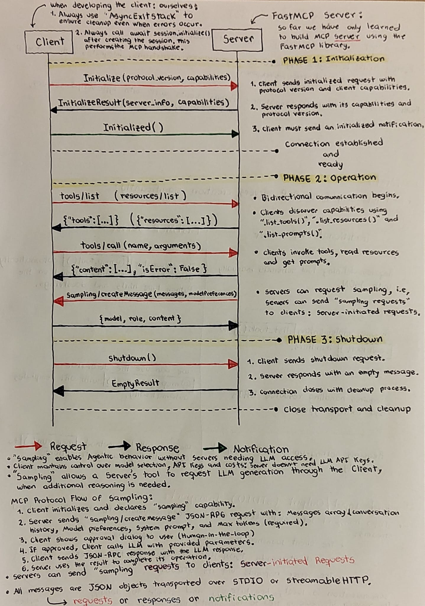

# AgenticAI-with-MCP
Code repository for an Agentic AI, consisting of an LLM with access to tools, prompts and resources, through the Model Context Protocol (MCP).

# Appendix
Repository with the Python code used for implementing a Multimodal (AI-powered) recommendation system.

  
